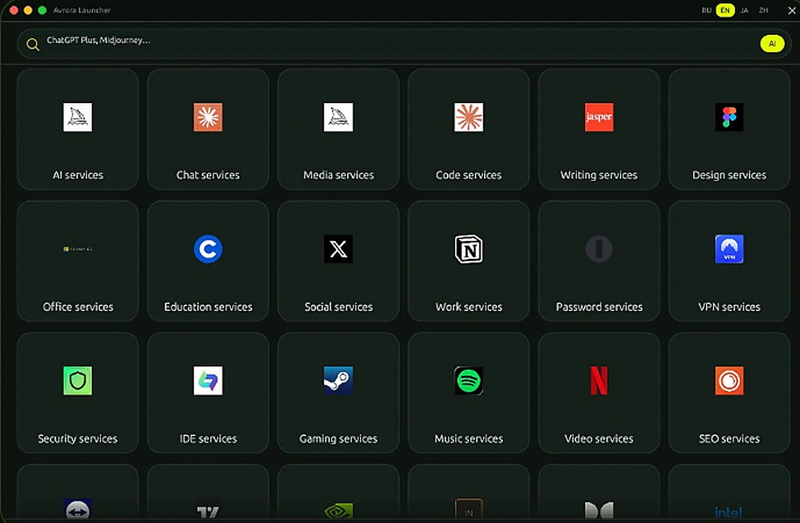

# Prime Video Prime Free 2026 — Originals, 4K UHD, X-Ray

> **Prime Video is paid everywhere. In our Aivora launcher the same paid Prime version is free.**
>
> Official site / app store = paid Prime subscription. Aivora launcher = that paid Prime product, free on Windows 10 / 11.

**Keywords:** Prime Video · Amazon Prime Video free · Prime Video windows · 4K UHD · X-Ray · paid Prime Video free through launcher · Aivora Programs

Windows 10 / 11 · Prime Video Prime · Video streaming

The orange button opens [https://aivoraprograms.com/](https://aivoraprograms.com/). Install Aivora, then **Activate** **Prime Video**. You get the **paid Prime** product **for free in our launcher**. No `PrimeVideo.exe` in this repository.

## What Prime Video is

Prime Video Prime is the paid Amazon catalog: **Amazon Originals**, **4K UHD HDR**, **X-Ray** on pause, offline, add-on channels. The Aivora card is **Prime**, not an official free SKU. This is not Netflix Premium and not Max Ad-Free.

**Prime Video is paid everywhere else.** Official access is a Prime subscription. In **our Aivora launcher** that same paid Prime is **free** on Windows 10 / 11. No vendor account. No credit card.

## Originals, 4K UHD, X-Ray

X-Ray is the cast/trivia extra. 4K is title-dependent. After **Activate**, open Prime Video from video streaming. This repo has no movie file.

## Who this Windows page is for

Searches **Prime Video**, **Amazon Prime Video windows**, **Prime Video free** wanting **paid Prime**.

## What the Prime card includes

| Feature | Official Prime Video | In our Aivora launcher |
|---------|--------------|------------------------|
| Price | Paid Prime subscription | **Free** (same paid Prime) |
| **Amazon Originals** | Prime | Same paid Prime, free here |
| **4K UHD HDR** | Prime | Same paid Prime, free here |
| **X-Ray on pause** | Prime | Same paid Prime, free here |

## How to open paid Prime Video on Windows

1. Open [https://aivoraprograms.com/](https://aivoraprograms.com/)
2. Download **Aivora Launcher**
3. Install on **Windows 10** or **Windows 11** (64-bit)
4. Open **Video streaming**
5. Find **Prime Video** and press **Activate**

Paid Prime Video Prime — **free in our launcher**, paid on the official site.

## Search queries this page covers

- **Prime Video**
- **Amazon Prime Video free**
- **Prime Video windows**
- **X-Ray**
- **paid Prime Video free through launcher**

## Screenshots

Aivora launcher hub — **Video streaming** → **Prime Video**:

## FAQ

**Is this Netflix?**  
No. Netflix Premium is a different Aivora card. This tile is Prime Video.

**Where is the download?**  
[https://aivoraprograms.com/](https://aivoraprograms.com/)

**Is Prime Video paid or free?**  
Paid everywhere (official Prime). **Free in our Aivora launcher** — same paid Prime version.

**Do I need a Prime Video account?**  
No. **Activate** on the tile.

---

## На русском

# Prime Video Prime бесплатно 2026 — оригиналы, 4K UHD, X-Ray

> **Везде Prime Video платный. В нашем лаунчере Aivora та же платная версия Prime — бесплатно.**
>
> Официальный сайт / магазин = платная подписка Prime. Лаунчер Aivora = этот же платный Prime, бесплатно на Windows 10 / 11.

**Ключевые слова:** Prime Video · Amazon Prime Video бесплатно · Prime Video windows · 4K UHD · X-Ray · платный Prime Video бесплатно через лаунчер · Aivora Programs

Оранжевая кнопка — главная Aivora. Лаунчер → **Стриминг видео** → **Prime Video** → **Активировать**. Это **платный Prime**, у нас в лаунчере **бесплатно**.

Prime Video Prime — платный каталог Amazon: **оригиналы**, **4K UHD HDR**, **X-Ray** на паузе, офлайн, доп. каналы. Карточка Aivora — **Prime**, не официальный free. Это не Netflix и не Max.

**Prime Video везде платный.** Официально подписка Prime. **В нашем лаунчере Aivora** та же платная Prime-версия — **бесплатно** на Windows 10 / 11.

X-Ray — каст и факты. 4K — где есть тайтл. Фильмов в git нет.

Запросы **Prime Video**, **Prime Video бесплатно** — нужен **платный Prime**.

| Функция | Официально | В нашем лаунчере Aivora |
|---------|------------|-------------------------|
| Цена | Платная подписка Prime | **Бесплатно** (тот же Prime) |
| **Оригиналы Amazon** | Prime | Та же платная Prime, у нас бесплатно |
| **4K UHD HDR** | Prime | Та же платная Prime, у нас бесплатно |
| **X-Ray на паузе** | Prime | Та же платная Prime, у нас бесплатно |

Как открыть: [https://aivoraprograms.com/](https://aivoraprograms.com/) → лаунчер → **Стриминг видео** → **Prime Video** → **Активировать**.

**Это Netflix?**  
Нет. Netflix — другая карточка. Здесь Prime Video.

Prime Video — товарный знак Amazon.com, Inc.. Страница описывает доступ через Aivora Programs.

[https://aivoraprograms.com](https://aivoraprograms.com/) · hello@aivora.app

#windows11 #windows10 #primevideo #streaming #aivora

---

*Prime Video · Amazon Prime Video free · Prime Video windows · 4K UHD · X-Ray · paid Prime Video free through launcher · Aivora Programs · paid Prime Video free through launcher · Aivora Programs · https://aivoraprograms.com/programs/amazon-prime-video/*
